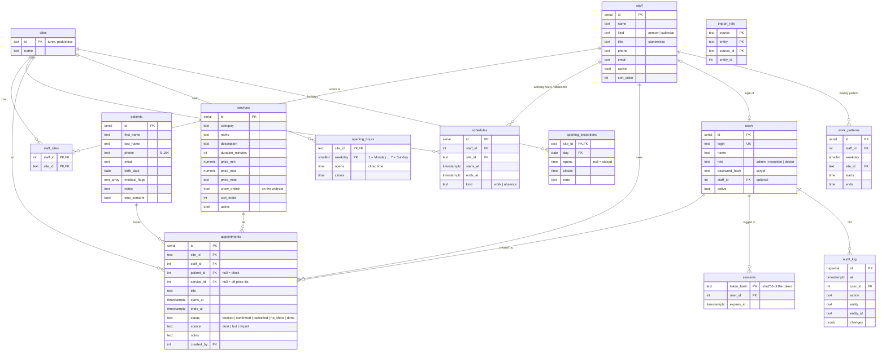

# Database schema

Source of truth: `migrations/` (`001_init.sql`, `002_settings.sql`). PostgreSQL 16.

Rules the database enforces:
- `appointments_no_overlap`: one staff member cannot have two live appointments at once (cancelled and no-show do not count).
- `price_max >= price_min`, `ends_at > starts_at`, durations above zero.
- Opening hours and work patterns are clinic-local times (Europe/Warsaw); a weekday without an `opening_hours` row is closed.
- `work_patterns` is the template; `schedules` holds the actual blocks the calendar shows. Generating from the pattern rewrites only `work` blocks, never absences.
- `import_refs` is used only by a one-off data import, so it can run again without duplicates. The app never reads it; it can be dropped after the move.
